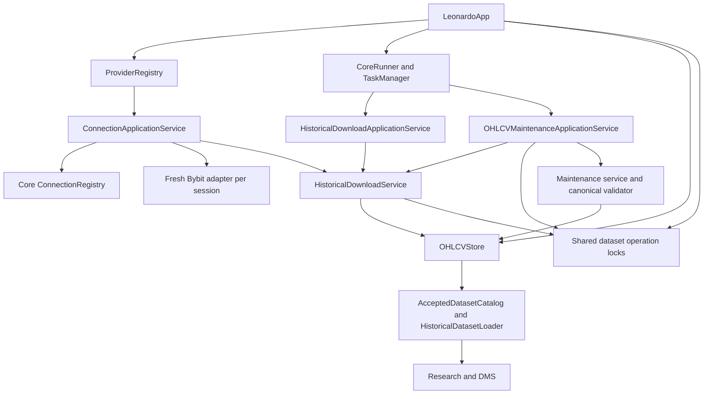

# Connection Suite - Architecture and Leonardo Integration

**Targeted revision: 2026-10-28 (R07).** Reconciles accepted R01-R06 and current source. Earlier edition dates and validation counts below remain historical; R08 integrated and R09 native acceptance are separate, not performed by this documentation revision.

**Updated:** 2026-10-09

**Development status:** Connection Suite is still incomplete and will undergo further development. Its structure can still change significantly. This document describes the current implementation, not a frozen future design.

Read with the [suite manual](CONNECTION_SUITE.md), [lifecycles](CONNECTION_LIFECYCLES.md), [contracts](CONNECTION_DATA_CONTRACTS.md) and [visual map](Leonardo_V2_Connection_Suite_Complete_Map.pdf). The map is additive. This is a reconstruction reference for the current implementation inside Leonardo, not an independent replacement for Core or OHLCV.

## 1. System boundary and authorities

| Concern | Current authoritative owner | What is only a projection or caller |
|---|---|---|
| Provider factories | Connection `ProviderRegistry` | Provider dropdown |
| Supported endpoints, parsing, pacing, retries | Concrete provider adapter | GUI capability lists and errors |
| Scoped provider sessions | `ConnectionApplicationService` | Coarse Core connection row |
| Generic connection state | Core `ConnectionRegistry` | Runtime Manager snapshot |
| Download plans and execution | OHLCV `HistoricalDownloadService` | Preflight and task displays |
| Task registration, execution and cancellation | CoreRunner / TaskManager | Application service submissions and presenter state |
| Canonical dataset paths and physical writes | `OHLCVStore` | Request form, reports and logs |
| Same-dataset mutation exclusion | Shared `OHLCVDatasetOperationLocks` | No GUI-owned lock authority |
| Final quality report and publication orchestration | Canonical validator / Maintenance service | Preliminary download report |
| Admission to Research | AcceptedDatasetCatalog and loader | Download success text |
| Widget lifetime and local interaction | Composition, presenters and windows | Core's window registry records |
| Saved Research/DMS objects | Their existing Areas/stores | Connection has no ownership or cascade-delete role |

ProviderRegistry and ConnectionRegistry are different objects: the former creates provider adapters, the latter records generic runtime summaries. Neither is a durable credentials/account repository. No global provider singleton or new service locator is involved.

## 2. Active production composition

`src/leonardo/core/app.py` constructs the shared services. `src/leonardo/gui/composition.py` injects them into retained windows and presenters. The fact that application composition lives under `core/` does not transfer Area-specific semantics into Core infrastructure.

The main application owns one configured historical root and supplies one mutation Store and one dataset-lock service to download/Maintenance. Catalog/loader may construct read-side Store wrappers; that is not a second physical write path. Maintenance receives `HistoricalDatasetLoader.invalidate` as its cache invalidator for the deletion/reconstruction paths that invoke it.

## 3. GUI composition and window identity

Composition lazily creates and retains the Connection home, Historical Download Manager/presenter and OHLCV Maintenance/presenter. Reopening shows and focuses the same window. Closing an ordinary window hides it; it does not replace the service graph or destroy persisted data.

| Window | Object/window ID | Lifetime and wiring |
|---|---|---|
| ConnectionSuiteWindow | `connection_suite.home.window` | Tracked suite shell; navigation wired to manager |
| HistoricalDownloadManagerWindow | `historical_download_manager.window` | Tracked workflow; retained HistoricalDownloadPresenter |
| OhlcvMaintenanceWindow | `ohlcv_maintenance.window` | Tracked workflow; discovery refreshes on reopen |
| OhlcvDownloadPreflightWindow | `ohlcv_download_preflight.window` | Presenter-owned child dialog; pending preflight has its own task ID |
| OhlcvDownloadTaskWindow | `ohlcv_download_task.window` | Presenter-owned child dialog; one retained active download |

The two dialogs have stable widget/object IDs but are not independently registered by this composition's long-lived window tracking. A title is not identity, and an object ID is not proof of an independent Core window row.

`HistoricalDownloadPresenter` owns form interpretation, the reviewed request, preflight identity, active download identity/request, progress throttling, cancellation intent and terminal rendering. Its windows own fields and presentation. The active download request survives a manager-form reset, so a delayed persistence event still resolves to the original MarketId.

## 4. Execution placement and concurrency

The Qt thread owns widgets and presenter callbacks. The shared CoreRunner registers async preflight/download jobs on its Core event loop. Blocking Store reads/writes and validation calls use existing worker facilities or `asyncio.to_thread`; the downloader's list conversion, filtering and merge execute in the coroutine on the Core loop. No new operating-system process is created.

Core callbacks are passed through `_QtCallbackDispatcher`, whose queued signal returns execution to Qt. `TaskProgress.details["download_event"]` carries the Area event. Application services assign correlation IDs and metadata; they do not turn preliminary feedback into canonical validation.

The active GUI permits one download per retained presenter. This is a GUI workflow constraint, not a global ban on independent service callers. Timeframes in a batch are sequential. Dataset locks key on the full MarketId and serialize actual download mutation, repair range execution, deletion and reconstruction against the same dataset. Store also uses an `RLock` for its physical write/publication operations.

Preflight does not acquire the mutation lock. Ordinary canonical validation uses stable before/after evidence plus optimistic publication, rather than holding the async dataset lock throughout a worker scan. Repair's shared lock covers the reviewed precondition, all provider-redownload ranges and the synchronous finalizer: repaired marking, canonical post-validation and result construction. Cancellation drains a begun finalizer before lock release. Do not describe the entire repair lifecycle as one indivisible transaction.

## 5. Provider boundary

The registry stores callable factories under trimmed lowercase names, rejects duplicate names and non-callables, returns sorted names, and checks factory results against the runtime-checkable HistoricalOHLCVProvider protocol. It calls a factory each time; freshness is the factory's responsibility and is supplied by the default factory.

Default registration creates `BybitHistoricalProvider(testnet=False)`. Capability queries instantiate an adapter but do not open a network session. Session entry creates an adapter, creates/updates the generic connection row, opens the adapter and yields it; exit always attempts adapter closure and updates active-session accounting. State changes and failure precedence are specified in lifecycle section 2.

The adapter owns aiohttp, Bybit URLs, parameters, response interpretation, timeframe closure, pacing and wire retry policy. OHLCV receives normalized ProviderCandle records and typed request failures, never exchange-specific JSON. Detailed timing and discovery algorithms are in contracts section 3.

## 6. Persistence, audit and projections

The historical root is `AppConfig.paths.historical_data_dir`. Connection has no independent persisted account database or download queue. Durable output is the OHLCV CSV/sidecar pair; generic audit output follows Core's configured audit sink. Runtime tasks, preflight plans, dialog tables, active-session counters and progress summaries are disposable.

Core owns task terminal status. The downloader emits `download.batch_started`, `download.page_persisted`, `download.item_cancelled`, `download.batch_cancelled`, `download.batch_failed` and `download.batch_completed`, category `ohlcv`, action `download.execute`, with correlation and Area details. Maintenance publishes its own validation/recovery/deletion evidence. GUI log text and registry summaries are observations, not a second dataset authority.

## 7. Integration and surviving references

The presenter forwards `source_evidence_changed` as well as the existing page-persisted/fetched-row fallback path, deduplicated per MarketId before UI throttling. The downloader compares CSV and sidecar witnesses in its finalization boundary even on failure: presence/path plus size, nanosecond mtime and inode when available; uncertain inspection conservatively notifies. Metadata-only finalization and split-write failures can therefore notify without fetched rows. Genuine unchanged/no-op and pre-mutation failures with unchanged evidence do not notify.

Composition forwards these changes to an already-open DMS presenter. For the selected market, DMS invalidates its selected context and closes/guards relevant editors according to its accepted rules; an unrelated market does not suspend the selected market. Maintenance separately forwards changed canonical evidence and accepted validation, allowing DMS to refresh the affected context. No new downstream ownership or compatibility rule is added.

Deletion and sidecar reconstruction explicitly invalidate the shared loader cache in their application paths. Do not generalize this callback to every successful download, validation or repair: those paths have their own evidence/consumer freshness checks. Research's catalog verifies admission, and its loader uses current evidence when loading. The Connection workflow does not push new candles into already-open charts or automatically recompute studies, Artifacts or Databases.

Deleting OHLCV through Maintenance removes reviewed canonical files only. It does not cascade-delete studies, saved Study Environments, Workspaces, Notebooks, Recipes, Artifacts, Collections or Databases. Their remaining source references are handled by their own owners when resolved; deletion is not a claim those references stay usable.

DMS independently compares current CSV/sidecar file identities and accepted metadata before cached proof reuse. Delayed or absent GUI invalidation cannot substitute for that check. This is not a watcher, full rehash on every hit or proof against hidden edits preserving the exact checked identities.

## 8. Source map and reconstruction order

Paths beginning with `src/` are relative to the repository root; other module paths are under `src/leonardo/`. Bare filenames in a row share the preceding module directory. Exact public interfaces and model fields appear in the contracts appendices.

| Order | Source group | Reconstruction responsibility |
|---|---|---|
| 1 | `src/leonardo/data/market_id.py`; `storage/sidecar_v1.py` | Canonical identity, month-safe storage segment and durable evidence contract |
| 2 | `connection/provider.py`, `registry.py`, `service.py`, `bybit.py` | Provider port, factory registry, scoped sessions and concrete public REST adapter |
| 3 | `ohlcv/models.py`, `store.py`, `operation_locks.py`, `validation.py` | Value objects, physical persistence, mutation exclusion and independent validation |
| 4 | `ohlcv/download_service.py` | Normalization, preflight, planning, backwards pages, no-op, retry and cancellation fences |
| 5 | `ohlcv/maintenance.py`, `application.py` | Reviewed recovery and deletion, canonical publication, Core submission boundaries |
| 6 | `research/catalog.py`, `research/dataset.py` | Existing accepted-data discovery and loading; no Connection-owned replacement |
| 7 | `core/app.py`, `gui/composition.py` | Build and inject shared production dependencies |
| 8 | `gui/presenters/historical_download_presenter.py`, `ohlcv_maintenance_presenter.py` | Identity, Qt dispatch, confirmation, progress, stale results and downstream notifications |
| 9 | `gui/windows/connection_suite_window.py`, `historical_download_manager_window.py`, `ohlcv_download_preflight_window.py`, `ohlcv_download_task_window.py`, `ohlcv_maintenance_window.py` | Presentation and local signals; wire only implemented services |
| 10 | `gui/window_tracking.py`, `gui/runner.py`, Core runtime | Existing tracking, guarded close and shutdown integration |

For a reconstruction, first implement the data contracts and owner-local behavior, then the existing application boundary, then GUI coordination. Verify each row of the contract test matrix before composing the full workflow. Reuse Leonardo's existing Core, DMS and Research policies. Python annotations and field inventories describe APIs; the algorithms and failure semantics in the other chapters are also necessary.

## 9. Evidence and scope of this edition

Canonical external evidence is under `Leo_V2_Task_Packages`, adjacent to the working repository:

| Directory | Purpose |
|---|---|
| `20261009_Connection_Correction_Workplan_And_Abort_Investigation` | Approved bounded correction plan and original abort investigation |
| `20261009_Connection_Corrections_Execution` | Implemented correction evidence, focused/full/native results |
| `20261009_Connection_Corrections_Package_Audit` | Independent bounded review, 225 fresh passing checks and preserved candidate hashes |
| `20261009_Connection_Documentation` | This edition's PRE/POST preservation, source inventory, document/link checks, PDF source and visual review |

The documentation baseline was verified against all 1,078 repository files and 391 protected files in the prior audit. Only this documentation set and its index entry are in the write allowance. No product code, tests, configuration, persistence schema, real saved data or Git index is changed.
