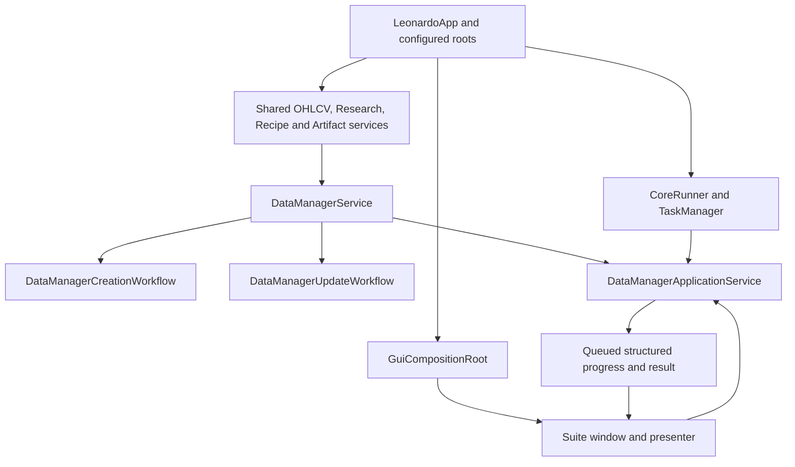
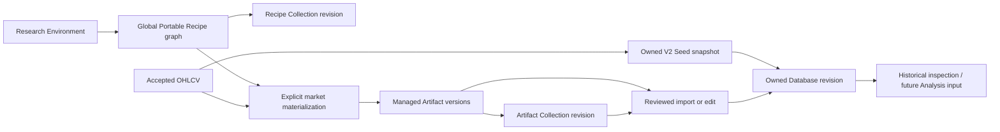

# Data Manager architecture and Leonardo integration

**Targeted revision: 2026-10-28 (R07).** Reconciles accepted R01-R06 and current source. Earlier edition dates and validation counts below remain historical; R08 integrated and R09 native acceptance are separate, not performed by this documentation revision.

**Updated:** 2026-10-08. **Basis:** current production composition and completed
DMS lifecycle audit, including the later Open Notebooks shortcut and shared
Research corrections. Read with [scope and commands](DATA_MANAGER.md),
[lifecycles](DATA_MANAGER_LIFECYCLES.md),
[contracts](DATA_MANAGER_DATA_CONTRACTS.md) and the
[companion map](Leonardo_V2_Data_Manager_Suite_Complete_Map.pdf).

## 1. System boundary

Data Manager Suite (DMS) is the interactive workspace for persisted research
products. It coordinates inspection, explicit creation, semantic reuse,
immutable revision publication, membership editing, reconciliation and reviewed
updates. It is part of Leonardo's desktop modular monolith, not a separate
database server or a replacement financial engine.

The GUI is replaceable. Domain rules remain in the Recipe, Artifact, Data Manager,
OHLCV and Research owners; shared Core owns execution and operational state.
The eight object roles span several Areas. Showing them together does not
transfer ownership into a universal object manager.

UTC's additional episode measurements (2026-10-15) follow these same owners:
Financial Tools computes/validates the nonvisual sibling report after the
unchanged detector; Artifacts serializes its complete analysis mapping; Data
Manager copies immutable provider reports into database revisions; Analysis
exposes detached provider-specific views. No new transaction, identity authority
or GUI calculation path is introduced. Formation conflict rules remain based
on the original classification, while evolving duration and pullbacks live in
the separate measurement section. See
[measurement definitions and lifecycle](../analysis_docs/UTC_EPISODE_MEASUREMENTS.md).

Here construction arrows identify injected dependencies and the return path;
they are not permission for worker code to manipulate Qt. The precise execution
call path is GUI intent -> presenter -> application service -> shared Core
blocking task -> domain/store/calculator -> queued GUI delivery.

## 2. Active production composition

`LeonardoApp` creates one accepted-dataset catalog and historical dataset loader,
the canonical Artifact service, Study Environment store, Portable Recipe store
and graph planner, Data Manager creation store, and Data Manager domain service.
The domain constructs its creation/update workflow coordinators using those same
dependencies. Its application-service wrapper receives the shared CoreRunner.
Configured paths are supplied by application configuration; windows must not
invent a root from their working directory.

`GuiCompositionRoot._open_data_manager_suite` constructs or reuses one
`DataManagerSuiteWindow` / `DataManagerSuitePresenter` pair. The presenter binds
window intentions, shared application services, source-change notifications and
queued result dispatch. Opening an already retained Suite focuses it, preserving
its current geometry. A newly constructed Suite starts maximized.

The **active tabs are Catalogs and Update & Reconcile**. Database creation uses
Catalog actions and bounded Seed/Database dialogs. The retained internal
nine-stage creation workspace and its helper methods are not an active Create
Database tab and are not mandatory steps in the current user workflow. A method
or test mentioning that workspace alone does not prove its production visibility.

The top strip contains Refresh, Select Dataset, Preview Dataset and Duplicate
Maintenance; Open Notebooks sits at the right. Product-specific actions belong
to the Catalog workspace. The selected market is a read-only summary. The
Inspector and Revision History share the bottom strip. These are presentation
surfaces, not persistence owners.

## 3. Canonical authority and state ownership

| State or rule | Owner | Derived consumers |
|---|---|---|
| Canonical market and timeframe | `MarketId` / canonical data helpers | All market filters, paths, plans and views |
| Candles and accepted validation evidence | OHLCV Store and Validator | DMS metadata catalog and checked operations |
| Immutable full dataset and bounded cache | `HistoricalDatasetLoader` | Preview/calculation/Seed operations |
| Environment definitions | Research Study Environment domain/store | DMS inspection and Recipe derivation |
| Portable semantic definitions, provenance, Recipe Collections | Recipe models, identity functions, `PortableRecipeStore` | Derivation, materialization and duplicate planning |
| Graph closure and topological Recipe stages | `PortableRecipeGraphPlanner` | Collection planning and materialization |
| Financial parameters, output schemas, eligibility, mathematics and update strategy | Financial Tools | Direct, Batch and update workflows |
| Artifact values, physical IDs, logical heads and lineage | `ArtifactService` | DMS catalog/creation/update; Research Save |
| Seeds, Artifact Collections, Database definitions/revisions/heads | `DataManagerCreationStore` | Creation/update workflows and catalog projections |
| Creation, membership and publication policy | `DataManagerCreationWorkflow` with DMS coordination | Reviewed GUI intentions |
| Reconciliation and update policy | `DataManagerUpdateWorkflow` | Currentness views and reviewed update execution |
| Operation integrity evidence for this DMS session/source generation | `DataManagerService` | Only checked consuming operations |
| Task identity, progress, cancellation and terminal result | Core `TaskManager`, executed by `CoreRunner` | Suite Operation, Runtime Manager and callbacks |
| Current selection, retained dialogs, matching request/run IDs | Presenter and live Qt widget tree | Button state and visible projections |
| Window runtime identity and accepted closure | `WindowRegistry` through `GuiWindowTracker` | Runtime inspection and composition reuse |

The Suite Operation panel is DMS's one foreground **presentation** of managed
work. It is not a second task authority. Background reconciliation uses the same
Core runtime but has separate request correlation and does not take over an
active foreground operation's progress or terminal report.

## 4. Object and dependency map

These arrows mean derivation, materialization or explicit copying, not automatic
subscription. A Database owns copied values. A Collection retains explicit
membership in immutable revisions. A Portable Recipe describes calculation and
is not an Artifact's runtime parent. Source deletion and member removal therefore
have different consequences; the lifecycle reference gives the exact matrix.

There are also genuine live references: a Recipe may require another Recipe;
historical Recipe Collection revisions can protect Recipes; Artifact lineage and
Artifact Collection history can protect Artifact versions. The distinction is
between a required domain reference and copied Database provenance, not merely
between "old" and "current" objects.

### Three independent identity questions

1. **Which calculation?** Global semantic Recipe equivalence resolves tool,
   parameters and actual direct input graph. Names and origin do not change it.
2. **Which market and saved result?** A logical Artifact groups a market-specific
   role; a physical Artifact version identifies exact source evidence, values
   and lineage. Its current head can advance without editing old versions.
3. **Which owned snapshot?** A Database ID retains a definition and a history of
   immutable revision IDs. Selection sources describe why a column is included;
   physical value segments describe which saved results supplied its values.

The three-rule materialized compatibility check is different from all three
identity schemes. It checks market, row count and endpoints; it does not erase
integrity, explicit roles, or stale-plan checks.

## 5. Application-service and execution contract

The presenter submits immutable requests/plans through `DataManagerApplicationService`.
Long work is submitted as a Core blocking operation and returns `TaskSubmission`.
Result delivery uses `TaskResult` and optional progress callbacks through the
existing dispatcher. Check terminal status and expected value type before
publishing a view; submission exceptions and terminal failures are different
paths and both must release only their matching pending state.

| Request family | Typical result / admission |
|---|---|
| Catalogs and inspection | Immutable summaries, exact inspected revision, bounded preview, reasons for invalid products |
| Recipe derivation / Collection planning | Root/support graph, planned actions, compatibility and blockers |
| Materialization / direct Artifact | Current source/heads and ordered nodes; truthful created/reused/version/head outcome |
| Batch | Explicit branch requests, New/Reuse Current decisions, destination, blockers; execution requires the reviewed request |
| Seed / Database creation | Captured source or Seed evidence, schema/columns/coverage and plan identity |
| Database content edit | Starting revision, exact removals/additions, final membership/ownership/provenance and blockers |
| Reconciliation | Read-only source/product currentness and evidence signature |
| Artifact / Database update | Separate reviewed plans; Artifact graph update versus Database suffix append |
| Delete / duplicate purge | Current dependency and stale-evidence checks at the operation's destructive boundary |

One foreground operation is admitted through the Suite at a time. Conflicting
actions and selection mutation are disabled, and domain execution rechecks the
reviewed evidence. Foreground exclusivity does not imply that all application
tasks or autonomous reconciliation have stopped.

Cancellation uses the existing `_CancellationGate` and Core cancellation request.
Before a destructive/publication boundary, a cooperative check may stop work.
After the gate has begun, a late cancel may be refused. GUI disappearance is not
proof that a durable write was cancelled. Final status belongs to TaskManager;
the view releases its matching operation after settlement and ignores obsolete
delivery. No new executor, event bus, task registry or universal transaction is
part of this design.

Both GUI derivation routes pass `expected_environment_content_hash=plan.environment_content_hash` through the existing application command. Execution compares two freshly built plans and the reviewed hash before persistence, then reloads and compares the Environment after the publication gate and before writes. A changed saved definition requires Preview again. Programmatic `None` retains the explicit no-preview compatibility path and execution-time checks; GUI requests must carry their token. Equivalent Recipe reuse and provenance remain separate from that reviewed-intent check.

The Operation view uses typed result evidence for `Published` and `Publication evidence`. New Artifacts, versions or advanced heads demonstrate publication; a materialization with only reused outputs and no returned Collection reports no new publication. A stored Collection revision alone does not reveal new versus reused and is reported as unknown. Construct batch combines its materialization result with the optional Collection result. Failed/cancelled status or an unexpected result type reports unknown, never inferred rollback. Recipe derivation separately reports created/reused Recipes, provenance and its explicit Collection outcome.

## 6. Validation effort and freshness boundaries

DMS catalog/currentness browsing deliberately reads metadata. It does not hash
every values payload whenever a table opens. Checked operations verify the inputs
they consume, their required dependency closure and newly generated outputs.
Removing saved Database content does not require unrelated original providers
or a full payload sweep of discarded sources.

`begin_session` advances a session generation and clears cached source evidence.
`invalidate_source(MarketId)` advances that market's generation, drops its
successful evidence and invalidates reconciliation. `end_session` invalidates
the session. A successful source check is reusable only for the same generation
and exact captured source evidence. Failed, cancelled or changing checks are not
cached. The cache retains verification identity and proven timestamps; full
OHLCV values remain in the loader's bounded cache.

The checked-source path parses/hashes the selected source against accepted
metadata. It is not another financial validator and does not repair candles.
Other consumers, including Research's normal loading boundary, keep their strict
checks. Before proof reuse, DMS compares session/market generation, exact accepted source metadata and both CSV/sidecar stat fingerprints `(st_size, st_mtime_ns, st_ino)` (inode defaults to zero when unavailable). Metadata and file identities are checked again before return. A mismatch drops cached proof and uses the existing strict loader parse/hash path; successful proof retains the timestamp axis, not another full-values cache. This protects against observed replacement even without GUI invalidation, not hostile same-stat tampering or continuous file watching.

## 7. GUI lifetime and reconciliation

The newly created presenter begins its evidence session. Warm-up is foreground:
show Suite -> reconcile -> product catalog scan -> apply valid catalogs -> mark
warm-up complete. Failure remains visible and retryable; Refresh retries with
force. Normal silent reconciliation begins only after successful initialization.
Application post-show reconciliation is scheduled once through the shared
service; it is not a replacement GUI state owner.

After warm-up, changed evidence triggers the needed catalog/market updates.
Unchanged evidence avoids unnecessary GUI churn. Pending market catch-up and
request coalescing prevent missed refreshes without permitting old results to
replace a newer selection. Successful mutation updates relevant catalog and
currently retained child views immediately; reconciliation verifies afterward.

Result acceptance qualifies the presenter generation, task ID, active context,
and retained dialog/plan. Closing a child invalidates its delivery target.
Changing market or plan inputs clears execution readiness. Suite disposal stops
scheduling, closes its children, requests cancellation and ends the evidence
session. Reopening constructs a new GUI pair; old delivery cannot attach to it.
Historical revision selection loads a read projection only and never moves a
persisted head.

## 8. Integration with Leonardo

### OHLCV, Connection and Maintenance

Connection/OHLCV acquire sources and Maintenance validates, repairs or explicitly
deletes them. DMS consumes acceptance, shows rejections and receives source-change
notifications. It does not have a dataset-delete action. Orphan persisted products
remain inspectable through All Datasets; missing OHLCV blocks only operations
that need it. The controlled Windows replacement recovery is described in the
lifecycle guide, without claiming that its original intermittent cause was fixed.

### Research and Notebooks

Research Apply is transient. Explicit Research Save publishes through canonical
Artifact and Portable Recipe services; those products then appear in DMS.
Research Environments are read as definition sources, not transferred into DMS
ownership. A Research market handoff carries `MarketId`; DMS reloads its own
persisted truth.

Open Notebooks emits `notebooks_requested` and GUI composition creates/focuses
the active Research Suite, then invokes its existing Notebook Manager action.
It can be used without an active DMS dataset when normal busy guards permit it.
Research owns drafts, assignments, dirty decisions and Notebook windows. Current
Research restore/Notebook admission still applies; the shortcut is not a bypass
or a second Notebook implementation. See the
[Research lifecycle reference](../research_docs/RESEARCH_LIFECYCLES.md).

### Financial Tools and future Analysis

Calls use canonical tool lookup, parameter resolution, output definitions,
construct-input eligibility, calculations and per-tool update policy. DMS does
not copy formulas into GUI code. Current Database revisions are suitable durable
inputs for downstream work; the current Analysis Suite shell is not evidence
of an implemented analysis/backtesting engine. Trading, risk and order execution
are outside DMS scope.

## 9. Source map and reconstruction order

Paths below are beneath `src/leonardo/`.

| Responsibility | Current source |
|---|---|
| Shared construction and paths | `core/app.py`, `core/config.py` |
| GUI entry and Notebook bridge | `gui/composition.py`, `gui/window_tracking.py` |
| Suite/presenter | `gui/windows/data_manager_suite_window.py`, `gui/presenters/data_manager_presenter.py` |
| Catalog and GUI coordination | `gui/data_manager/catalogs.py`, `creation.py`, `update.py`, `operations.py`, `reconciliation.py`, `table_presentation.py` |
| Domain projection and orchestration | `data_manager/service.py`, `models.py`, `application.py` |
| Direct, Batch and saved sources | `data_manager/direct_artifact.py`, `construct_sources.py`, `construct_batch.py`, `artifact_materialization.py` |
| Creation, edits and persistence | `data_manager/creation_service.py`, `creation_models.py`, `creation_store.py` |
| Currentness and updates | `data_manager/update_service.py`, `update_models.py` |
| Global definitions | `recipes/models.py`, `identity.py`, `planner.py`, `store.py` |
| Saved calculated values | `artifacts/models.py`, `identity.py`, `service.py`, `serialization.py` |
| Mathematical boundary | `financial_tools/specifications.py`, `calculation.py`, `models.py`, `construct_input_eligibility.json` |

Within each row, short subsequent filenames use the preceding directory. Bounded
dialogs live in `gui/windows/data_manager_*.py`; the entry manual lists their
exact window identities. Legacy/internal creation helpers must not be used as
the production navigation specification.

To reconstruct DMS inside Leonardo: establish shared external contracts and path
injection; implement durable models and safe stores; prove Recipe semantic graph
identity and Artifact publication; implement Seed/Database owned snapshots and
membership/provenance; add scoped operation integrity checks; add explicit update
and cancellation fences; expose immutable application-service requests/results;
then construct the actual Catalogs/update GUI, reconciliation and disposal.
Use the contract guide's acceptance matrix at each boundary. Reconstructing the
whole Leonardo numerical library additionally requires its canonical Financial
Tools specifications and numerical fixtures; DMS documentation does not replace
those authorities.

## UTC classification carriage (2026-10-13 extension)

UTC's canonical Financial Tools scanner owns its nonvisual formation and
continuation evidence. Data Manager's existing Artifact calculation calls supply
market/source/dependency context and proven bar-close timing; the calculator
does not access stores. Research supplies equivalent dataset context at its own
calculation boundary. Existing Artifact serialization carries the validated
`analysis.utc_classification` mapping without a new Artifact storage authority.

`utc_classification_snapshot.py` captures only UTC physical providers represented
by selected database outputs. `DataManagerCreationService` connects it to the
existing build/edit/append publisher; `DataManagerCreationStore` atomically owns
the additional V6 sidecar. Reports and output coverage are copied into each
revision, deduplicated by analysis hash, and validated against physical value
provenance. Loads do not resolve live Artifact heads.

The Analysis backend reads a pinned revision through that store. It exposes
separate UTC report/coverage views and leaves numeric binning eligibility intact.
No chart output, plotting owner, DMS compatibility criterion, streaming detector
or database rebuild operation is added. Full semantics and field contracts are
in [UTC classification](../analysis_docs/UTC_CLASSIFICATION.md).
