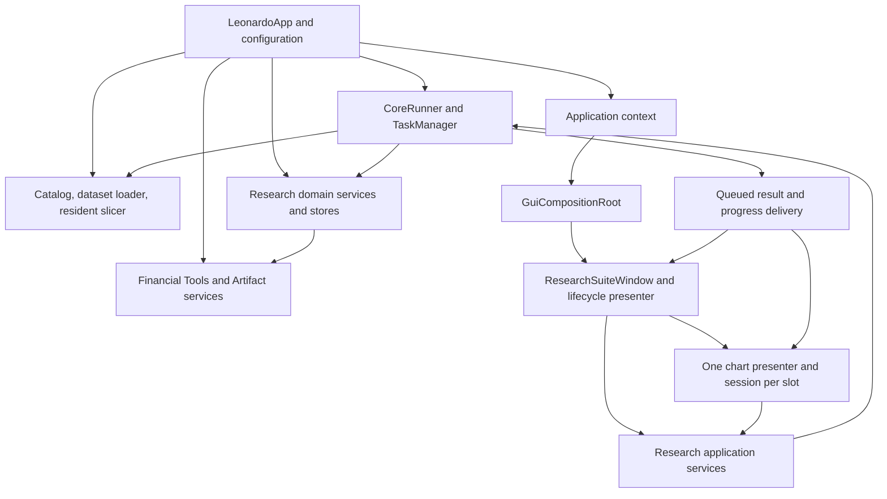

# Research Suite architecture and Leonardo integration

**Updated:** 2026-10-08. **Baseline:** active production composition through A4.
Read with [scope and behavior](RESEARCH_SUITE.md),
[lifecycles](RESEARCH_LIFECYCLES.md) and [contracts](RESEARCH_DATA_CONTRACTS.md).

## 1. System boundary

Research is a consumer of accepted historical OHLCV and canonical Financial Tool
calculations, and an author of research-specific saved context. It supplies the
interactive workspace within Leonardo. It is not a second download engine,
database manager, calculation library or task runtime.

The visible Suite can be closed and recreated while the application and shared
services continue to exist. Its chart sessions and unsaved presentation are
transient. Explicitly saved objects outlive windows and application restarts.
Shared immutable data can be reused; mutable session, Study and viewport state
belongs to the individual chart.



The arrows describe call/dependency direction. They do not create additional
ownership or imply that widgets run in worker threads.

## 2. Production composition

1. `LeonardoApp` receives configured paths and constructs the Core runtime,
   canonical OHLCV store/catalog/loader, resident slicing service, Artifact
   service and Portable Recipe store.
2. It creates Research Study, Study Setup, Notebook and Snapshot domains and
   stores. The Snapshot/Notebook link service receives the same Snapshot store
   and Notebook domain. Application-service wrappers receive the shared
   `CoreRunner`; no window creates a private runner or independent store root.
3. The application context exposes `research_dataset_service`,
   `research_study_service`, `research_study_setup_service`,
   `research_workspace_snapshot_service`, and `research_notebook_service`.
4. `GuiCompositionRoot._open_research_suite` creates or focuses the retained
   Suite. `create_restored_research_suite` creates `ResearchSuiteWindow` and
   `RestoredResearchLifecyclePresenter` and injects those services and the
   existing window tracker.
5. The lifecycle presenter owns GUI orchestration, the workspace membership
   model, per-chart presenters, retained dialogs and correlated composite runs.
   `ResearchWorkspaceWidget` owns widget placement with its shell model.
6. Each occupied logical slot has one `ChartSessionState` and one
   `ResearchChartPresenter`. The presenter connects session read models to the
   panel, candle widget, panes and navigation. It submits long work through
   application services.
7. Accepted Suite closure disposes this GUI graph. A subsequent opening creates
   fresh sessions and dialogs with fresh identities. Saved pools and the shared
   services are retained by the application.

The active classes live in `gui/research/`. The older
`gui/windows/research_suite_window.py` and `gui/presenters/research_presenter.py`
remain in the repository but are not the main application's Research controller.
Tests of those older classes alone cannot establish production behavior.

## 3. Responsibility and state ownership

| Component | Authoritative responsibility | Must not own |
|---|---|---|
| `MarketId` and canonicalization | Exchange, market type, symbol, timeframe identity and storage mapping | Widget identity or a symbol-only market key |
| OHLCV store/validator | CSV persistence and durable validation evidence | Research session lifetime |
| `AcceptedDatasetCatalog` | Read-only Research admission/rejection with reasons | Repair or validation-status mutation |
| `HistoricalDatasetLoader` | Checked immutable full data and disposable cache | A silently updated live chart |
| `ResidentSliceService` | Immutable bounded projections by full-data fingerprint and range | Financial calculation truth |
| `ResearchWorkspaceState` | Slot membership, active session, session disposal | Screen placement or durable snapshots |
| `ResearchWorkspaceShellState` | Position, move/swap, detached reservation and attached order | Study state or market identity |
| `ChartSessionState` | Dataset generation, accepted attempts, Study registry and presentation | Core terminal task status |
| `HorizontalViewport` | Chart-space camera, padding, zoom and refill interest | Timestamp-to-market mapping |
| Research Study domain | Input resolution, result preparation, durable source checks | Qt mutation or formulas copied from Financial Tools |
| Financial Tools | Parameters, roles, outputs, eligibility and calculation mathematics | Chart lifetime |
| Artifact services/Portable Recipe store | Durable identities, lineage and publication | Research pool/session deletion policy |
| Study Setup domain | Setup catalog, Environment definitions and compatibility | A second task scheduler |
| Snapshot domain/store | Capture transformation, compatibility and durable Snapshot | Live widget restoration |
| Notebook domain/store | Notebook validation/persistence and annotation projection | Trades or financial signals |
| Snapshot/Notebook link service | Serialized durable assignment and coordinated reference cleanup | Ownership of Notebook by one Snapshot |
| Lifecycle/chart presenters | GUI sequencing, current target checks and view updates | Persistence truth or task terminal states |
| CoreRunner/TaskManager | Execution, IDs, progress, cancellation and terminal results | Financial meaning |
| WindowRegistry/GuiWindowTracker | Runtime window identity and accepted closure | Window titles as identity |

There is no contradiction between a GUI coordinator retaining a task ID and
Core owning tasks: the retained ID correlates a result with its intended view.
Likewise, an enabled flag is a derived view of admission, not another authority.

## 4. Runtime object graph

```text
Application (long-lived)
  shared services + Core runtime + configured stores
  GUI composition
    optional current Research Suite
      lifecycle presenter
        workspace membership: slot ID -> ChartSessionState
        chart presenters: slot ID -> one presenter
        secondary dialogs: logical context -> one retained window
        current Snapshot ID + assigned Notebook ID (live context)
        optional Notebook editor + last valid draft
      workspace widget
        shell placement: slot ID -> position + detached flag
        same chart panel either attached or in detached window
```

The following identities must remain distinct:

- **Slot ID:** 1..16; reusable only after removal. It does not by itself prove a
  late result still belongs to the chart now occupying that slot.
- **Session ID:** unique per session. Dataset generation and request identity
  further qualify an operation within that session.
- **Workspace position:** 1..16 presentation placement; changing it does not
  change slot, session or Study identity.
- **Study ID:** chart-local runtime result identity. Dependency edges refer to
  this ID while the session lives.
- **Environment entry ID / Snapshot chart reference:** durable identities inside
  saved definitions. On restore they map to newly allocated runtime identities.
- **Environment/Snapshot/Notebook ID:** pool identity, independent of editable
  names and content hash.
- **Recipe/Artifact ID:** deterministic identity defined by their canonical
  services; it is not a chart ID or an Environment entry ID.

### User-interface composition

| Surface | Commands and context |
|---|---|
| File | New Chart; Save/Load/Manage Study Environments; Save/Load/Manage Workspaces; Clear Research Suite; Close |
| Window | Pan Anchor; mutually exclusive Scroll 4 and Fit 8 |
| Notes | Open Assigned Notebook; Notebook Manager |
| Menu-bar quick actions | Reuse the same actions for Notebook, Save/Load Environment, Save/Load Workspace, Clear and Pan Anchor |
| Chart control bar | Market label; Position 1..16; Go to; Financial Tools; Studies; Detach; Close; Autoscale |
| Chart panes | Price overlays and oscillator controls for values, visibility, style, edit/removal and pane arrangement |
| Research Activity | Retractable status/history for this Suite; it is not a second task registry |

The active-chart context supplies ordinary Environment save/load targets; the
dialogs can select a valid source/target chart explicitly. Save Environment
requires a ready source with Studies. Load requires a ready target and current
compatibility. Management can list saved definitions independently of whether a
chart has Studies. Workspace Save additionally validates every captured chart;
the presence of one ready chart alone does not waive capture checks.

Chart controls sit below the chart, with the market label yielding width first;
Position must display two-digit positions within the existing control footprint.
Menus and quick controls share QAction state. Core/GUI admission can still
refuse a command whose view was enabled immediately before a state change.
Generic window colors/fonts come from Leonardo's static theme; Study appearance
is separately editable. The accepted visual hierarchy and 0..8 arrangements are
preserved when laying out charts 9..16.

## 5. Application-service contract

Application services accept immutable requests/captures, submit work through
`CoreRunner`, and return `TaskSubmission`. They accept result/progress callbacks
and a dispatcher. `TaskResult` carries task identity, terminal status, result
value and error information; callers must check status and expected value type
before publication. Submission exceptions and failed/cancelled terminal results
are separate paths and both must release the GUI's matching pending state.

| Application service | Requests and successful values |
|---|---|
| Dataset | Catalog -> `DatasetCatalogReport`; load MarketId -> `HistoricalDataset`; resident request -> `ResidentOHLCVSlice` |
| Study | Calculation/Artifact Apply or Edit -> `PreparedStudy`; Save -> `StudySaveOutcome` |
| Study Setup | Setup catalog -> available tools/sources/Artifacts; Environment list/load/create/update/delete; compatibility -> blockers/warnings; save chart definitions -> saved Environment |
| Snapshot | List/load/create/update/delete -> summaries or Snapshot; preflight -> chart/global blockers, warnings and Append position plan; assign/unassign -> updated Snapshot |
| Notebook | List/load/create/update/delete -> summaries or Notebook; projection is a direct, read-only domain operation |

The exact operation metadata strings are listed in the main manual's Core task
section. Keep them stable for Runtime Manager traceability. Do not invent a
separate GUI success state that overrides a failed Core result.

For long work, the callback dispatcher posts to the live Qt presenter. Worker
threads do not touch widgets. Before publishing, the presenter checks its
disposed flag, retained task/run/dialog identity and the target session. The
session then verifies generation, request, market and fingerprint where relevant.
An obsolete result is discarded; it cannot attach to a reused slot or new Suite.

Cancelling a read/calculation requests cooperative cancellation and can prevent
publication. Durable operations use their existing persistence fence. Once a
fenced write has begun, cancellation may be refused and the write may finish
after its window closes. Its real terminal result remains in Core; the retired
GUI must drop delivery without raising an exception into the completed job.
The application services remove their cancellation bookkeeping at terminal
completion even when no GUI callback is delivered.

Workspace restore, Environment application and multi-save workflows coordinate
individual Core tasks. Their run IDs are correlation state, not parent Core
tasks. There is no current parent/child umbrella task hierarchy and Research
launches no child operating-system process.

## 6. Integration with the rest of Leonardo

### Download and Maintenance

Provider acquisition writes through the OHLCV pipeline. Maintenance owns
diagnosis, repair, validation and cache invalidation after its mutation. Research
reads only accepted current data. New Chart refreshes the catalog each opening;
an already loaded chart remains on its immutable old fingerprint. This separates
catalog freshness from deliberately deferred live chart hot-reload.

### Financial Tools

Research supplies the complete accepted timestamp axis, OHLCV data, canonical
parameters and resolved named bindings to `calculate_financial_tool`. It consumes
the returned output schema, role flags, values and analysis payload. It does not
infer output meaning from a display label or recalculate a moving visible window.
There are 25 Research tools; global `dynamic_binning` is excluded from Research
catalogs, requests, Artifact application and Environment application.

The interface consists of canonical tool lookup, parameter resolution, output
resolution, construct-input eligibility and calculation. These are defined by
[Financial Tool specifications](../../src/leonardo/financial_tools/specifications.py),
[eligibility rules](../../src/leonardo/financial_tools/construct_input_eligibility.json),
[calculation models](../../src/leonardo/financial_tools/calculation_models.py) and
[calculation entry point](../../src/leonardo/financial_tools/calculation.py).
These links are implementation traceability; the Research behavior expected of
their callers is specified in the lifecycle and data references.

### Artifacts and Data Manager

Study Save passes its existing full result and durable source references to
`ArtifactService`. It also publishes global Portable Recipes and managed
Artifact versions through the existing authorities. DMS subsequently sees these
objects in its pools. Research does not insert them into a Database, subscribe a
Database to a collection, alter DMS compatibility rules, or replace DMS update
and append policy. The [Data Manager manual](../data_manager_docs/DATA_MANAGER.md)
defines those subsequent operations.

An `ArtifactRecipeV1` is a market-bound saved calculation recipe; a
`PortableRecipeV1` is a global reusable definition. A managed Artifact remains
market/source-specific. An Environment is a separate Research pool object; it
does not own those Artifacts or Portable Recipes.

DMS **Open Notebooks...** routes through the shared GUI composition, opening or
reusing Research and its Notebook Manager. It does not create a second Notebook
implementation or bypass current busy/restore admission.

### Runtime and window tracking

The [Core runtime](../core_docs/LIGHT_V2_RUNTIME.md) retains authoritative task and
window state. Long-lived Research dialogs use the identities in the main
manual. Reuse focuses the same context; a different chart/Study context has a
different ID. A vetoed close must leave the window registered as open with no
closed timestamp. Main-window cancellation preserves Research and the other
suites. Short-lived confirmation message boxes are not independent durable
runtime windows.

### Persistence roots

Paths come from application configuration, not the process working directory or
a directory invented by a window. Defaults are `historical_data/`,
`data_manager/`, `study_environments/`, `workspace_snapshots/`, and
`research_notebooks/`. See [data contracts](RESEARCH_DATA_CONTRACTS.md) for their
contents. Tests inject disposable roots. A Research Clear/close/restore never
cleans these roots.

## 7. Source map by implementation responsibility

Paths below are relative to the repository root.

| Responsibility | Current implementation |
|---|---|
| Shared construction and configuration | `src/leonardo/core/app.py`, `src/leonardo/core/config.py` |
| Entry, reuse, close/reopen, DMS shortcut | `src/leonardo/gui/composition.py`, `gui/research/composition.py`, `gui/window_tracking.py` |
| Main Research commands and orchestration | `gui/research/suite_window.py`, `gui/research/lifecycle_presenter.py` |
| Slot/session/placement state | `research/workspace.py`, `research/session.py`, `research/workspace_shell.py` |
| Per-chart controller, panel and detached view | `gui/presenters/research_chart_presenter.py`, `gui/research/chart_panel.py`, `gui/research/detached_chart_window.py` |
| Layout and widget tree | `gui/widgets/research_workspace_layout.py`, `gui/research/workspace_widget.py` |
| Data admission/loading/resident/navigation | `research/catalog.py`, `dataset.py`, `resident.py`, `viewport.py`, `application.py` |
| Study requests/results/dependencies/execution | `research/studies.py`, `study_execution.py`, `study_application.py` |
| Rendering/presentation/projection | `research/study_projection.py`, `study_presentation.py`, `volume.py`, `gui/chart/`, `gui/research/pane_overlays.py` |
| Tool forms and catalogs | `research/study_setup.py`, `study_setup_service.py`, `study_setup_application.py`, `gui/research/financial_tools_dialog.py` |
| Saved Environment | `research/study_environment.py`, `study_environment_store.py`, `gui/windows/study_environment_*.py` |
| Saved Snapshot | `research/workspace_snapshot.py`, `workspace_snapshot_service.py`, `workspace_snapshot_application.py`, `workspace_snapshot_store.py`, `gui/windows/workspace_snapshot_*.py` |
| Notebook and assignments | `research/notebook.py`, `notebook_service.py`, `notebook_application.py`, `notebook_store.py`, `workspace_notebook_link.py`, `gui/windows/research_notebook_*.py` |

Short paths beginning `gui/` or `research/` in this table are beneath
`src/leonardo/`. These are implementation modules, not independent authorities
to be duplicated when rebuilding a GUI.

## 8. Reconstruction and verification order

1. Establish canonical external contracts: Core submission/dispatch, MarketId,
   accepted OHLCV, Financial Tools and Artifact operations. Inject paths/services.
2. Implement immutable models, validation, canonical serialization and stores.
   Verify model/store examples and rejection cases before adding windows.
3. Implement full-data loading, resident slicing, session attempts and viewport
   mathematics; prove stale-result refusal and same-market session independence.
4. Add Study Apply/Edit/Save and dependency rules. Verify full-axis numerical
   results, NaN placement, durable lineage and explicit Save fencing.
5. Build one chart panel and presenter, then membership, shell placement,
   adaptive layout, panes, detach/dock and timestamp navigation.
6. Add Environment definition capture, compatibility and transactional live
   application, then Snapshot preflight, ordered restore and recovery.
7. Add Notebook editor/drafts/annotations, serialized assignments and deletion.
   Complete dirty transitions before enabling owner close, restore and Clear.
8. Wire the actual application composition and DMS shortcut, Core tracking,
   disposal and reopen. Verify the active path, not only isolated legacy views.

The acceptance matrix in the data reference supplies observable criteria and
current executable evidence. A recreated implementation should satisfy those
contracts; passing tests alone does not authorize changed product behavior.
